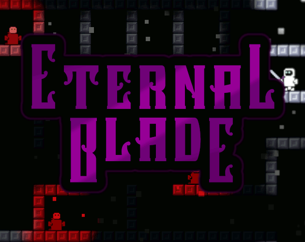

## You Are The Weapon

**[Play on itch.io](https://bifrostgames.itch.io/eternal-blade)** | **[Game Design Doc](https://docs.google.com/document/d/1zjTeOjho5ybUgabLkFJdvdTrM4i8631OWLiW3k0VPKc/edit?usp=sharing)**

*Unity project for Eternal Blade | Completed in 2 weeks for the [Pirate Software Game Jam 16](https://itch.io/jam/pirate16/rate/3263162)*

**Sacrifice the wielder to save the blade.**

You aren't the hero, you are the sword. Explore an infinite, procedurally generated dungeon as a blade passed from wielder to wielder. Every wielder is expendable, and you'll need to spend them wisely.

<!--  -->

> It's a bug! It's a feature! Try attacking enemies through walls or ceilings...

---

## How It Works

- **Fight through the dungeon** as the sword, slashing enemies and blocking projectiles.
- **Drain your wielder's health** to heal the sword. Your wielder's life is your resource.
- **When a wielder falls,** a new one picks up the blade and the run restarts from the beginning of the last dungeon.
- **When the sword breaks,** you can sacrifice the current wielder to restore the sword to full health.
- **Three wielders per run,** each with a unique stat distribution. The run ends once all three have fallen.
- **Earn and spend coins.** Enemies drop coins you can spend between dungeon clears on sword and wielder health.

---

## Controls

| Action | Key |
|--------|-----|
| Move | Arrow Keys |
| Attack | Z |
| Heal Sword (drains wielder health) | X |

---

## Screenshots

  

  

  

  

  

---

## Tools
 
| Purpose | Tools |
|---------|-------|
| Engine | Unity |
| Music and SFX | Audacity, Waveform |
| Art and animation | Aseprite, GIMP |

---

## Credits
- Made by Ben Laube
- **[Auto Shadow Caster 2D Creator](https://www.youtube.com/watch?v=n3tgimClTrI)** by [Rehope Games (Murat)](https://www.youtube.com/@RehopeGames) - Used to automatically generate 2D shadow casters on Tilemaps.
